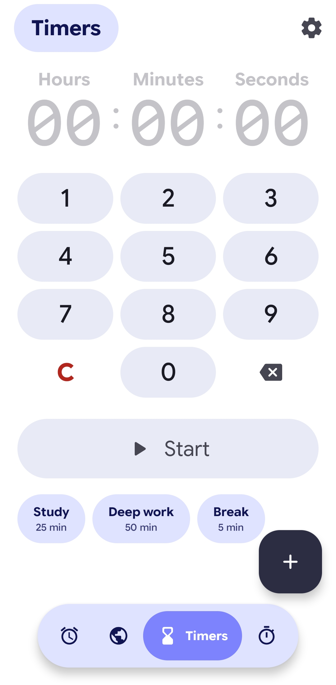

🕒 Clock

Material 3 Expressive Clock for Android

A modern Android Clock application built entirely with Jetpack Compose, inspired by Google's Material 3 Expressive research concept.

Material 3 Expressive • Jetpack Compose • Android • Kotlin

---

📖 About

A Material 3 Expressive design-based Android Clock App built entirely with Jetpack Compose.

This repository contains a functional, fully realized Android application based on Google's unshipped Material 3 Expressive research-concept clock.

Unlike static UI mockups, this is a real Compose application that builds, installs, and runs natively on Android.

The design is carefully extrapolated from Google's 46-study design program, specifically the concept renders rather than the production Google Clock 8.8.

Source renders and detailed measurements used to build the interface can be found in "../clock-mockups/reference/concept/".

---

📸 App Screenshots

Explore the Material 3 Expressive interface across all four clock features.

⏰ Alarms

  

🌍 World Clock

  

⏳ Timers

  

⏱️ Stopwatch

  

---

✨ Features

The application expands on the original three-tab research concept (Alarms, Map, Settings) to provide a complete clock utility with four distinct tabs.

⏰ Alarms

Expressive, gesture-friendly alarm management based closely on the original Material 3 research concepts.

🌍 World Clock

Global time tracking featuring the extrapolated design language of the Expressive study.

⏳ Timers

Clean, highly visible countdown interfaces tailored for daily use.

⏱️ Stopwatch

A precise time-tracking tool designed from the ground up to fit the broader Material 3 Expressive ecosystem.

---

🛠️ Technical Implementation

100% Jetpack Compose

Built entirely using modern, declarative UI principles.

Material 3 Expressive Motion & Styling

Implements the bold, fluid typography and dynamic scaling found in the research documentation.

Custom Typography Integration

Leverages advanced variable font capabilities to match the precise aesthetic intent of the original study.

---

💻 Technology Stack

Technology| Description
Kotlin| Android application development
Jetpack Compose| Declarative user interface
Material 3 Expressive| Design language and styling
Android| Native application platform
Custom Typography| Variable font integration

---

📂 Screenshots Directory

All application screenshots are available in the repository's "screenshot" directory.

"📸 View All Screenshots" (https://github.com/aiwriter447-web/material-clock/tree/main/screenshot)

---

📜 License

This project's own code is licensed under the MIT License.

See the "LICENSE" (LICENSE) file for details.

---

📚 Third-Party Materials & Attribution

This project bundles two font binaries which are not covered by the MIT License:

- Google Sans Flex — SIL Open Font License 1.1
- Noto Sans Arabic — Ten-glyph subset, SIL Open Font License 1.1

Detailed copyright notices, modifications, and the full text of the SIL Open Font License are available in:

- "THIRD-PARTY-NOTICES.md" (THIRD-PARTY-NOTICES.md)
- "licenses/OFL-1.1.txt" (licenses/OFL-1.1.txt)

---

⚖️ Trademarks

Google, Google Sans, Material, Android, and Pixel are trademarks of Google LLC.

This project is an independent recreation of a published Material 3 Expressive concept design.

It is not affiliated with, sponsored by, or endorsed by Google.

The original concept renders used as a measurement reference remain the copyright of Google and are not included in this repository.

---

⭐ Support

If you find this project interesting, consider giving the repository a ⭐ star.

Your support is appreciated!

---

🕒 Material 3 Expressive Clock

Designed with Material 3 Expressive • Built with Jetpack Compose

Made for Android ❤️

